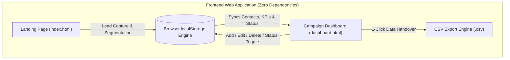

# Marketing Automation Engine: Custom Lead Capture & Analytics Dashboard

A responsive, zero-dependency **Marketing Automation & Analytics Dashboard Demo** featuring an interactive **Lead Capture Landing Page** and real-time **Campaign Analytics Dashboard** with instant bidirectional data synchronization, audience segmentation, and CSV reporting.

---

## 🌟 Key Features

### 1. Interactive Lead Capture Landing Page (`index.html`)
- **Modern Design & Dark/Light Theming**: Clean glassmorphism styling with instant Dark / Light mode toggle switch.
- **Live Social Proof Ticker**: Real-time rotating pill showcasing recent subscribers, companies, and segments.
- **Instant Validation & Auto-Fill**: Client-side validation for First Name, Last Name, Work Email, Company, and GDPR Consent with a 1-click **🎲 Auto-Fill** demo helper.
- **Dynamic Segmentation**: Leads choose their primary interest topic (*Email Marketing*, *Lead Generation*, *Automation*, *Analytics*) with automated journey preview tips.
- **Bi-directional Live Sync**: Submissions automatically sync to the Campaign Dashboard, Activity Stream, and Audience Segments via `localStorage`.
- **Celebration Confetti Engine**: Zero-dependency canvas particle burst celebrating successful registration.
- **Visual Lead Pipeline**: Interactive 4-step pipeline diagram detailing form capture, segmentation, drip enrollment, and analytics.
- **Interactive ROI Calculator**: Real-time slider comparing annual costs of Mailchimp, HubSpot, and self-hosted Mautic.
- **Interactive FAQ Accordion**: Smooth collapsible accordion answering key questions regarding privacy, CRM exports, and real-time syncing.

### 2. Real-Time Marketing Analytics Dashboard (`dashboard.html`)
- **Theme Switcher**: Seamless Dark/Light theme toggle persistent across sessions.
- **Dynamic KPI Cards**: Animated counters for **Total Leads**, **Emails Sent**, **Avg Open Rate (%)**, and **Avg Click Rate (%)**, calculated dynamically from stored contacts and campaigns.
- **Dual Engagement Charts**:
  - Interactive **Bar Chart** with hover tooltips detailing opens and clicks.
  - Smooth **SVG Curve Trend Chart** with gradient fill and interactive data point nodes.
  - Date Range Filtering: Filter analytics by *Last 7 Days*, *Last 9 Days*, *Last 14 Days*, or *Last 30 Days*.
- **Device Breakdown**: SVG Donut chart comparing Mobile, Desktop, and Tablet conversions.
- **Live Real-Time Activity Stream**: Live audit trail logging campaign sends, contact signups, and condition triggers.
- **Comprehensive Lead Management**:
  - Full-text search by name, email, or company.
  - Multi-select filters for **Audience Segments** and **Subscription Status**.
  - **Sortable Columns**: Click table headers (Name, Email, Company, Segment, Date, Status) to sort ascending / descending with visual indicators.
  - **Bulk Selection & Actions**: Master checkbox with floating action bar to bulk subscribe, unsubscribe, export selected, or delete.
  - **Contact Intelligence Drawer**: Slide-over panel displaying contact details, lead intent score (e.g. 88/100), and a multi-step customer journey timeline.
  - Direct **+ Add Lead** modal to record new contacts without leaving the dashboard.
  - 1-click **📥 Export to CSV** for marketing team handoff and CRM import.
  - Reset to sample data button.
- **Marketing Automation Workflows Section**:
  - Dedicated visual workflow canvas showcasing automated drip sequences, lead qualification pipelines, and retention campaigns.
  - **⚡ Test Run Simulation**: Interactive runner that sequentially highlights each step in real time with animated feedback.
- **Campaigns Control Center**:
  - Filter campaigns by status tabs (*All*, *Active*, *Paused*, *Draft*).
  - **Email Client Preview Modal**: Live mockup showing rendered email subject, segment, branded body copy, and unsubscribe links.
  - Create new campaigns with custom send dates, subject lines, and segment targeting.
  - Toggle campaign status (Active / Paused) and run **🚀 Simulate Send** batches to test KPI responses.
- **Dynamic Audience Segments**:
  - Live contact volume tracking per segment (*Email Marketing*, *Lead Generation*, *Automation*, *Analytics*).
  - Visual distribution progress bars and percentages.
- **Embed Code Configurator**:
  - Real-time embed script generator where you can adjust host URL and Form ID with 1-click clipboard copy.

---

## 🏗️ Architecture



---

## 📁 Project Structure

```
mautic-demo/
├── index.html               # Lead capture landing page
├── dashboard.html           # Marketing analytics & leads management dashboard
├── style.css                # Dark-mode design system & UI components
├── app.js                   # Interactive logic, chart engine, CSV exporter & data sync
├── server.py                # Local Python development server with auto-browser launch
├── start-demo.bat           # 1-click Windows runner script
├── .gitignore               # Clean git tracking exclusions
└── README.md                # Project documentation
```

---

## 🚀 Quick Start (Zero Setup Required)

Everything runs directly in your browser with no installation, build step, or external database required.

### Option 1: 1-Click Launch (Windows)
Double-click `start-demo.bat`:
```powershell
.\start-demo.bat
```

### Option 2: Python Local Server
```powershell
python server.py
```
This automatically launches your default browser at:
- **Landing Page:** `http://localhost:3000/index.html`
- **Dashboard:** `http://localhost:3000/dashboard.html`

### Option 3: Direct File Open
Simply double-click `index.html` or open it directly in Google Chrome, Microsoft Edge, Firefox, or Safari.

---

## 📊 CSV Export & Reporting

The Campaign Dashboard includes an instant **📥 Export CSV** button located in the top navigation bar and the Leads tab:
- Exports contact name, email, company, segment, registration date, and subscription status.
- Compatible with Excel, Google Sheets, HubSpot, Mailchimp, and Salesforce imports.

---

## 🛡️ Business Value & Impact

- **Zero Software Licensing Fees:** Replaces commercial SaaS marketing automation mockups with an independent, customized dashboard.
- **100% Client-Side Privacy:** Personal contact data resides in your browser's private storage, making GDPR compliance simple.
- **Extensible Design:** Built with pure HTML5, CSS3 variables, and vanilla ES6 JavaScript—easy to customize, embed, or integrate into any web framework.
